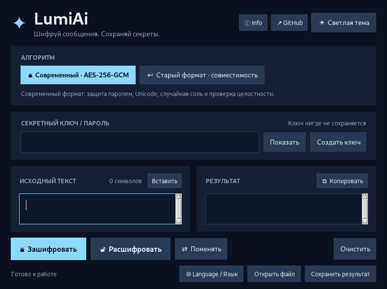

<div align="center">

# ✦ LumiAi
### A little message, a lot more privacy.

**A clean desktop app for encrypting and decrypting messages.**  
**Простое приложение для шифрования и расшифровки сообщений.**


[English](#-english) · [Русский](#-русский) · [Source code](LumiAi.py) · [Author](https://github.com/serge9900)



</div>

---

## 🇬🇧 English

**LumiAi** is a personal desktop application made by **Sergey Vardanyan**, developed from his earlier Python project, `encode_and_decode.py` (preserved in this repository). It pairs a dark/light interface with modern authenticated encryption and a legacy decoder.

### ✨ Features

- 🔐 **AES-256-GCM** authenticated encryption; new random salt and nonce for each message.
- 🗝️ Password-based key derivation using PBKDF2-HMAC-SHA256 (600,000 iterations); convenient random password generator.
- 🌍 Full Unicode: English, Russian, Armenian, emojis and multiline text.
- 🌓 Dark / light themes; **English / Русский** interface with remembered language choice.
- ⌨️ Copy, paste, select all, cut and undo with keyboard shortcuts — including fixes for non-Latin Windows keyboard layouts.
- 📁 Load encrypted messages and save `.lumi` ciphertext or unencrypted `.txt` results.
- ↩️ Legacy message decoding for compatibility with the original application.
- ℹ️ About / GitHub shortcuts for project information.

### 🚀 Run on Windows

1. Download or clone this repository.
2. Install [Python 3.10+](https://www.python.org/downloads/windows/) and enable **Add Python to PATH**.
3. Double-click `Start_LumiAi.bat`. The launcher installs the required Python package if needed.
4. Enter a password, type or paste your message, and choose **Encrypt** or **Decrypt**.

**Run from a terminal:**

```powershell
py -3 -m pip install -r requirements.txt
py -3 LumiAi.py
```

> The repository contains Python source code, **not a precompiled `.exe`**. First launch may require internet access to install the `cryptography` dependency.

### 🛡️ Security notes

- The **modern mode** uses AES-GCM with a 256-bit derived key. Save your password: it cannot be recovered by the application.
- The **legacy mode** is a historical compatibility feature, **not secure encryption**. Avoid it for sensitive information.
- LumiAi doesn't save message text or passwords in its language-settings file. The UI may hold them in memory while open.
- Clipboard contents, copied ciphertext and exported `.txt` files are **not protected** by LumiAi. Store and share them thoughtfully.
- A minimum of eight password characters is enforced in modern mode, but use a **long, unique passphrase** for meaningful protection.
- This is a personal software project, **not a formally audited security product**.

### 🧪 Tests

```powershell
py -3 LumiAi.py --self-test
```

GUI tests are under [`tests/`](tests/), require a graphical display and can be run from the repository root using `PYTHONPATH=.`. See [SECURITY.md](SECURITY.md) for security considerations.

### 📂 Project layout

```text
LumiAi.py                # Desktop app and crypto logic
Start_LumiAi.bat          # Windows launcher
requirements.txt          # Python dependencies
docs/screenshot.png       # Desktop screenshot
tests/                    # Automated checks
encode_and_decode.py      # Original historical project (preserved)
README.md                 # Project homepage (EN / RU)
CHANGELOG.md              # Version history
SECURITY.md               # Security notes
```

---

## 🇷🇺 Русский

**LumiAi** — программа для шифрования сообщений, созданная **Сергеем Варданяном**. Это современное продолжение оригинального проекта `encode_and_decode.py`, который сохранён в репозитории.

### ✨ Возможности

- 🔐 **AES-256-GCM**: шифрование с проверкой целостности и новыми случайными параметрами для каждого сообщения.
- 🗝️ Создание ключа на основе пароля, а также встроенный генератор паролей.
- 🌍 Русский, английский, армянский, эмодзи и многострочный текст.
- 🌓 Тёмная и светлая темы; интерфейс **Русский / English** с запоминанием выбора.
- ⌨️ Горячие клавиши Ctrl+C/V/X/A/Z/Y, включая исправления для русской раскладки Windows.
- 📁 Открытие файлов, сохранение зашифрованного результата в `.lumi` и расшифрованного текста в `.txt`.
- ↩️ Совместимость со старыми зашифрованными сообщениями.
- ℹ️ Кнопки Info и GitHub в верхней части окна.

### 🚀 Как запустить

1. Скачай репозиторий через **Code → Download ZIP** и распакуй его.
2. Установи [Python 3.10+](https://www.python.org/downloads/windows/) с галочкой **Add Python to PATH**.
3. Дважды щёлкни по `Start_LumiAi.bat`. Если необходимо, установится библиотека `cryptography`.
4. Введи пароль, вставь текст, нажми **«Зашифровать»** или **«Расшифровать»**.

**Запуск через терминал:**

```powershell
py -3 -m pip install -r requirements.txt
py -3 LumiAi.py
```

> Пока программа распространяется как исходный код на Python, а **не готовый `.exe`**.

### 🔒 Важно о безопасности

- Современный режим предназначен для защиты сообщений. Пароль нигде не восстанавливается — сохрани его надёжно.
- **Старый алгоритм небезопасен** и нужен только для совместимости.
- Открытый текст в `.txt`, содержимое буфера обмена и информация на экране не шифруются автоматически.
- Используй длинные уникальные пароли. Проект **не проходил независимый аудит безопасности**.

### 🧪 Проверка

```powershell
py -3 LumiAi.py --self-test
```

---

<div align="center">

## ☕ Support LumiAi · Поддержать LumiAi

**Enjoy LumiAi? Support further development with an optional crypto donation.** 💙  
**Нравится LumiAi? Можно поддержать дальнейшую разработку добровольным криптодонатом.** 💙

<a href="https://app.binance.com/uni-qr/Jv3MYVZ8">
  
</a>

**[💛 Support via Binance Pay · Поддержать через Binance Pay](https://app.binance.com/uni-qr/Jv3MYVZ8)**

<sub>Open the link in Binance or scan the QR code in the Binance app.<br/>Открой ссылку в Binance или отсканируй QR-код через приложение Binance.</sub>

**Recipient / Получатель:** `User-92ef9`  
**Payment:** Crypto via Binance Pay — not a bank card or PayPal transfer.

<sub>Donations are entirely optional; LumiAi remains free. Verify the recipient displayed in Binance before confirming a transfer.<br/>Поддержка полностью добровольная, LumiAi остаётся бесплатной. Перед отправкой проверь получателя в приложении Binance.</sub>

</div>

---

<div align="center">

**Made by [Sergey Vardanyan](https://github.com/serge9900) · LumiAi v2.8**  
*From an old idea to a modern little desktop app.* ✦

</div>
